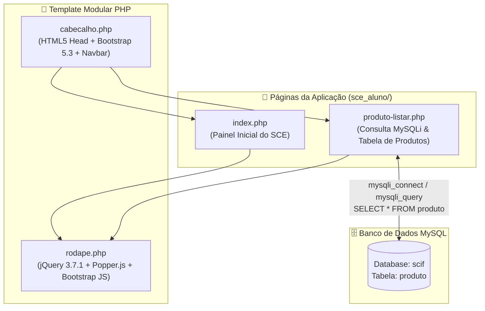

# 📦 SCE — Sistema de Controle de Estoque (Programação Web II)


Aplicação web desenvolvida na disciplina de **Programação Web II (PW2 — IFSULDEMINAS)** para estudo prático de **PHP estruturado/modularizado**, integração com banco de dados relacional **MySQL via extensão `mysqli`** e construção de interfaces responsivas com **Bootstrap 5.3**.

---

## 🏗️ Arquitetura e Estrutura Modular

O projeto implementa o padrão de reaproveitamento de layout em PHP (`include`) separando cabeçalho, barra de navegação, conteúdo principal e rodapé com scripts:



---

## 📁 Estrutura de Diretórios

```text
PW2/
├── README.md                         # Documentação do projeto
└── sce_aluno/
    ├── index.php                     # Página inicial do Sistema de Controle de Estoque
    ├── cabecalho.php                 # Cabeçalho HTML5 e Navbar responsiva Bootstrap
    ├── rodape.php                    # Rodapé e importação de scripts JS
    ├── produto-listar.php            # Conexão MySQLi e listagem tabular de produtos
    ├── database.sql                  # Script SQL para criação do banco `scif` e tabela `produto`
    ├── css/
    │   └── bootstrap.css             # Folha de estilos Bootstrap 5.3
    └── js/
        ├── jquery-3.7.1.min.js       # Biblioteca jQuery 3.7.1
        ├── popper.min.js             # Posicionamento de dropdowns e tooltips
        └── bootstrap.js              # Componentes interativos Bootstrap 5.3
```

---

## 🗄️ Configuração do Banco de Dados (`scif`)

O módulo [`sce_aluno/produto-listar.php`](./sce_aluno/produto-listar.php) realiza conexão com o banco MySQL local (`scif`) e consulta a tabela `produto`. Para criar a estrutura do banco, execute o script [`sce_aluno/database.sql`](./sce_aluno/database.sql):

```sql
CREATE DATABASE IF NOT EXISTS scif CHARACTER SET utf8mb4 COLLATE utf8mb4_unicode_ci;
USE scif;

CREATE TABLE IF NOT EXISTS produto (
    id INT AUTO_INCREMENT PRIMARY KEY,
    nome VARCHAR(120) NOT NULL,
    valor DECIMAL(10, 2) NOT NULL DEFAULT 0.00
);

INSERT INTO produto (nome, valor) VALUES
    ('Teclado Mecânico ABNT2', 189.90),
    ('Mouse Óptico USB', 49.50),
    ('Monitor LED 24 Polegadas', 699.00);
```

---

## 🚀 Como Executar o Projeto

### Pré-requisitos
- **PHP 7.4+ ou 8.x** (com extensão `php-mysqli` habilitada)
- **MySQL / MariaDB** (ou ambiente integrado como XAMPP, Laragon ou LAMP)

### Passo a Passo

1. Clone o repositório:
   ```bash
   git clone https://github.com/AmandoLuizDaCruz/PW2.git
   cd PW2
   ```
2. Importe o banco de dados no MySQL:
   ```bash
   mysql -u root -p < sce_aluno/database.sql
   ```
   *(Nota: ajuste as credenciais em `sce_aluno/produto-listar.php` caso a senha do seu usuário `root` local seja diferente de `ifsuldeminas`).*
3. Inicie o servidor embutido do PHP apontando para o diretório `sce_aluno/`:
   ```bash
   php -S localhost:8080 -t sce_aluno
   ```
4. Acesse no navegador:
   - **Página Inicial:** `http://localhost:8080/index.php`
   - **Listagem de Produtos:** `http://localhost:8080/produto-listar.php`

---

## 👨‍💻 Autor

**Amando Luiz da Cruz** — [GitHub](https://github.com/AmandoLuizDaCruz)  
*Instituto Federal de Educação, Ciência e Tecnologia do Sul de Minas Gerais (IFSULDEMINAS)*
